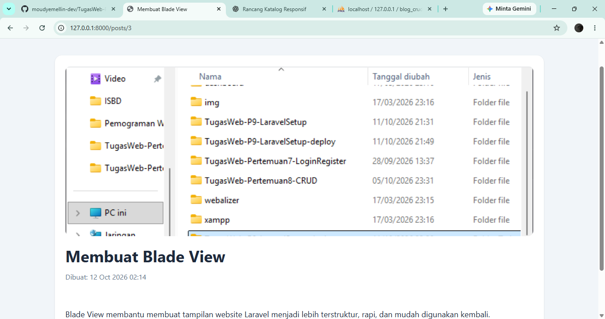
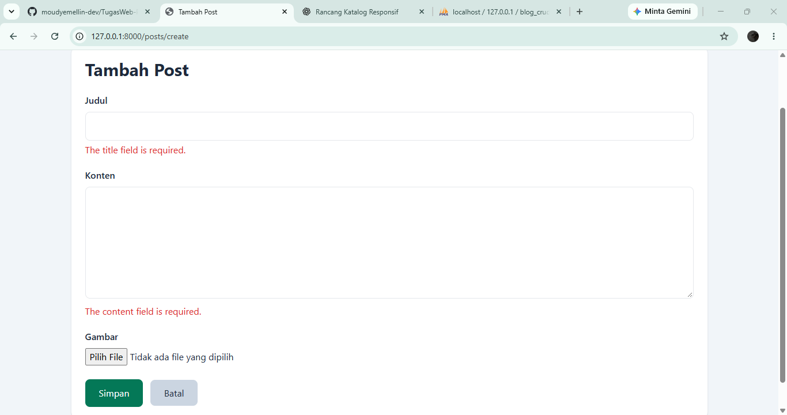
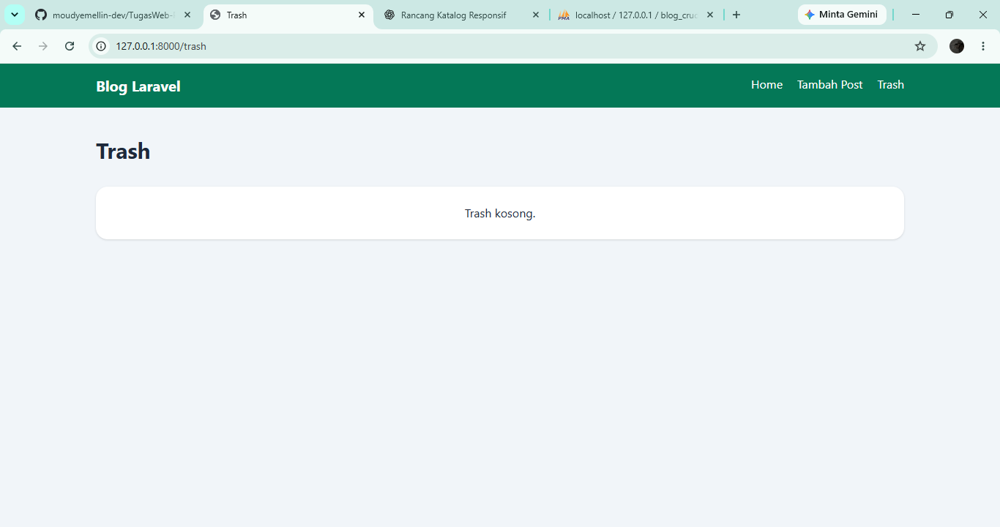
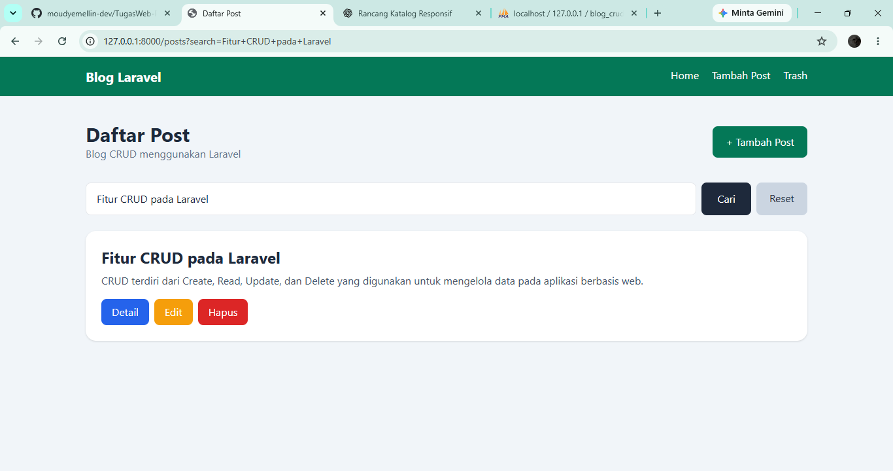

# Tugas Rutin 10 - Blog CRUD Laravel

Project ini dibuat untuk memenuhi **Tugas Rutin 10 Pemrograman Web** dengan menerapkan CRUD menggunakan Laravel.

## Identitas

- Nama: Moudy Emellin
- Mata Kuliah: Pemrograman Web
- Project: Tugas Rutin 10 - Blog CRUD
- Framework: Laravel
- Database: MySQL

## Fitur

- CRUD Post
- Resource Controller
- Resource Routing
- Named Route
- Blade Layout
- Blade Components
- Validation
- Old Input
- Flash Message
- CSRF Protection
- Method PUT dan DELETE
- Route Model Binding
- Pagination
- Search Post
- Soft Delete
- Trash
- Restore Post
- Hapus Permanen
- Upload Gambar

## Resource Route

Project menggunakan:

```php
Route::resource('posts', PostController::class);
```

Route utama yang tersedia:

| Route | Fungsi |
|---|---|
| `posts.index` | Menampilkan daftar post |
| `posts.create` | Form tambah post |
| `posts.store` | Menyimpan post |
| `posts.show` | Detail post |
| `posts.edit` | Form edit post |
| `posts.update` | Memperbarui post |
| `posts.destroy` | Menghapus post |
| `posts.trash` | Menampilkan trash |
| `posts.restore` | Restore post |
| `posts.forceDelete` | Hapus permanen |

## PostController

Resource Controller memiliki 7 method utama:

```text
index()
create()
store()
show()
edit()
update()
destroy()
```

Method tambahan:

```text
trash()
restore()
forceDelete()
```

## Blade Layout

Project menggunakan master layout:

```text
resources/views/layouts/app.blade.php
```

Halaman lain menggunakan:

```php
@extends('layouts.app')
```

dan master layout menggunakan:

```php
@yield('content')
```

## Blade Components

Project menggunakan minimal dua Blade Component:

```text
resources/views/components/
├── alert.blade.php
└── card.blade.php
```

### Alert Component

Digunakan untuk menampilkan flash message berhasil atau gagal.

### Card Component

Digunakan sebagai komponen tampilan card pada halaman Blog.

## Validation

Validation digunakan pada proses tambah dan edit post.

Contoh:

```php
'title' => 'required|max:255',
'content' => 'required|min:10',
'image' => 'nullable|image|mimes:jpg,jpeg,png,webp|max:2048',
```

Error ditampilkan per field menggunakan:

```php
@error('title')
    {{ $message }}
@enderror
```

Input lama dipertahankan menggunakan:

```php
old('title')
```

## Security

Semua form menggunakan:

```php
@csrf
```

Update menggunakan:

```php
@method('PUT')
```

Delete menggunakan:

```php
@method('DELETE')
```

## Route Model Binding

Contoh penggunaan Route Model Binding:

```php
public function show(Post $post)
public function edit(Post $post)
public function update(Request $request, Post $post)
public function destroy(Post $post)
```

## Pagination

Data post dibatasi 5 data setiap halaman:

```php
paginate(5)
```

Sehingga ketika jumlah post lebih dari 5, pagination akan muncul.

## Bonus

### 1. Search

Post dapat dicari berdasarkan judul atau konten.

### 2. Soft Delete

Post yang dihapus tidak langsung hilang permanen, tetapi masuk ke halaman Trash.

Fitur yang tersedia:

```text
Delete
Trash
Restore
Force Delete
```

### 3. Image Upload

Post dapat memiliki gambar dengan format:

```text
jpg
jpeg
png
webp
```

Gambar disimpan pada storage Laravel.

## Struktur Folder Utama

```text
TugasWeb-P10-BlogCRUD/
├── app/
│   ├── Http/
│   │   └── Controllers/
│   │       └── PostController.php
│   └── Models/
│       └── Post.php
├── database/
│   └── migrations/
├── public/
├── resources/
│   └── views/
│       ├── components/
│       │   ├── alert.blade.php
│       │   └── card.blade.php
│       ├── layouts/
│       │   └── app.blade.php
│       └── posts/
│           ├── index.blade.php
│           ├── create.blade.php
│           ├── edit.blade.php
│           ├── show.blade.php
│           └── trash.blade.php
├── routes/
│   └── web.php
├── screenshots/
├── storage/
├── .env.example
├── artisan
├── composer.json
└── README.md
```

## Instalasi Project

1. Clone repository:

```bash
git clone https://github.com/moudyemellin-dev/TugasWeb-P10-BlogCRUD.git
```

2. Masuk ke folder:

```bash
cd TugasWeb-P10-BlogCRUD
```

3. Install dependency:

```bash
composer install
```

4. Copy environment:

```bash
copy .env.example .env
```

5. Generate key:

```bash
php artisan key:generate
```

6. Buat database:

```text
blog_crud_db
```

7. Atur `.env`:

```env
DB_CONNECTION=mysql
DB_HOST=127.0.0.1
DB_PORT=3306
DB_DATABASE=blog_crud_db
DB_USERNAME=root
DB_PASSWORD=
```

8. Jalankan migration:

```bash
php artisan migrate
```

9. Buat storage link:

```bash
php artisan storage:link
```

10. Jalankan Laravel:

```bash
php artisan serve
```

11. Buka:

```text
http://127.0.0.1:8000
```

## Screenshot

### Daftar Post


### Upload Gambar


### Validation


### Trash


### Search


## Live Demo

🌐 [Buka Website Tugas Rutin 10 - Blog CRUD Laravel](https://moudy-crud10.infy.click/posts)
